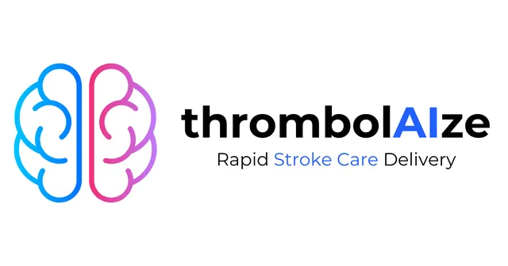
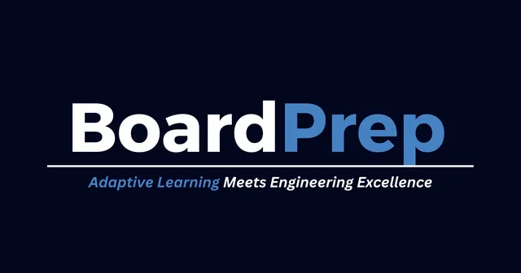
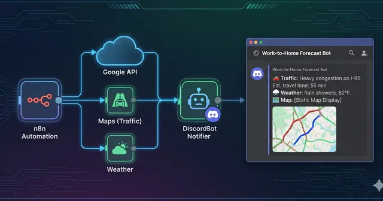
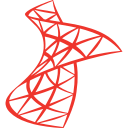
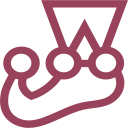

<h1 align="center">Hi! I'm Bronn👋</h1>

<p align="center">
  
</p>

- 🤖 I'm an **AI Engineer at Smartsourcing**, co-leading the development of **production-ready AI agents** and **scalable internal platforms** that automate complex workflows

- 🎤 I speak about **AI in healthcare** and **AI in the workplace** at research conferences and corporate trainings

- 🎓 Graduated **Cum Laude** with a **BS in Computer Science** from **Cebu Institute of Technology–University**, and a **PhilNITS FE (Level 2) Gold Medal** awardee

- 📫 Reach me at **[lebronnsamson@gmail.com](mailto:lebronnsamson@gmail.com)** · See my work at **[bronny.dev](https://bronny.dev)** · Connect on **[LinkedIn](https://www.linkedin.com/in/lebronnsamson/)**

- ⚡ Off the clock, you'll find me on the basketball or pickleball court, hiking trails, or coffee-hopping around Cebu City

<details>
<summary><b>🏆 Achievements &amp; Milestones</b></summary>
<br/>

| | Milestone | Details |
|:-:|---|---|
| 🎓 | **Cum Laude, BS Computer Science** | Cebu Institute of Technology–University · 2021 – 2025 |
| 🥇 | **PhilNITS FE (Level 2) Gold Medal** | Passed the ITPEC Fundamental IT Engineers exam, based on Japan's IT engineer standards · 2024 – 2025 |
| 🧠 | **4th Best Student Research** | Presented AI for stroke detection and patient triage at the 10th Central Visayas Health Research &amp; Innovation Conference · May 2025 |
| 🎤 | **Speaker, AI Essentials at Work** | Shared how to apply AI in the workplace at a corporate training in Lapu-Lapu City, Cebu · Oct 2026 |

</details>

<details>
<summary><b>🔭 Currently Learning</b></summary>
<br/>

- 🧩 **AI Agents Orchestration &amp; Engineering**: coordinating multiple agents, tools, and evaluations in production

</details>

<h2 align="left">💼 Featured Projects</h2>

<table>
  <tr>
    <td align="center" width="33%" valign="top">
      <a href="https://bronny.dev/project/thrombolaize/"></a>
      <h3>🧠 Thrombolaize</h3>
      <sub>Mobile · AI · 2025</sub>
      <p>A mobile app powered by an AI image classifier and segmentation model that identifies cerebral ischemic strokes.</p>
      <sub><code>Kotlin</code> <code>FastAPI</code> <code>Firebase</code> <code>CNN</code></sub>
      <br/><br/>
      <a href="https://bronny.dev/project/thrombolaize/">Details</a> · <a href="https://github.com/lbronn/Thrombolaize-Mobile-App">Code</a>
    </td>
    <td align="center" width="33%" valign="top">
      <a href="https://bronny.dev/project/boardprep/"></a>
      <h3>📚 BoardPrep</h3>
      <sub>Web app · AI · 2024</sub>
      <p>A full-stack web app that helps engineering students prepare with personalized, AI-tailored content and assessments.</p>
      <sub><code>React</code> <code>TypeScript</code> <code>Django</code> <code>PostgreSQL</code></sub>
      <br/><br/>
      <a href="https://bronny.dev/project/boardprep/">Details</a> · <a href="https://github.com/lbronn/BoardPrep-Final-Backend">Code</a>
    </td>
    <td align="center" width="33%" valign="top">
      <a href="https://bronny.dev/project/work-to-home/"></a>
      <h3>🚗 Work-to-Home Forecast</h3>
      <sub>Automation · n8n · 2025</sub>
      <p>An n8n automation that posts a commute briefing (traffic, weather, and a route map) to Discord.</p>
      <sub><code>n8n</code> <code>Google APIs</code> <code>Discord</code></sub>
      <br/><br/>
      <a href="https://bronny.dev/project/work-to-home/">Details</a>
    </td>
  </tr>
</table>

<h2 align="left">📊 Spent Time per Languages</h2>


<!--START_SECTION:waka-->

```txt
Total Time: 1,179 hrs 10 mins

Python            429 hrs 37 mins       ████████▓░░░░░░░░░░░░░░░░   34.32 %
Markdown          300 hrs 34 mins       ██████░░░░░░░░░░░░░░░░░░░   24.01 %
Text              119 hrs 47 mins       ██▒░░░░░░░░░░░░░░░░░░░░░░   09.57 %
```

<!--END_SECTION:waka-->

<h2 align="left">👨‍💻 My Tech Stack</h2>

### 🛠️ Software Engineering

<sub>Building scalable, full-stack software and internal platforms — from interfaces and APIs to databases and integrations.</sub>

<table>
  <tr>
    <td align="center" width="110"><br/><sub>Python</sub></td>
    <td align="center" width="110"><br/><sub>TypeScript</sub></td>
    <td align="center" width="110"><br/><sub>JavaScript</sub></td>
    <td align="center" width="110"><br/><sub>React</sub></td>
    <td align="center" width="110"><br/><sub>Django</sub></td>
    <td align="center" width="110"><br/><sub>FastAPI</sub></td>
  </tr>
  <tr>
    <td align="center" width="110"><br/><sub>PostgreSQL</sub></td>
    <td align="center" width="110"><br/><sub>MS SQL Server</sub></td>
    <td align="center" width="110"><br/><sub>Supabase</sub></td>
    <td align="center" width="110"><br/><sub>Playwright</sub></td>
    <td align="center" width="110"><br/><sub>Jest</sub></td>
    <td align="center" width="110"><br/><sub>Cypress</sub></td>
  </tr>
</table>

### 🤖 AI Engineering

<sub>Designing and deploying production-ready AI agents, RAG systems, and intelligent workflows through LLM integration, orchestration, and evaluation.</sub>

<table>
  <tr>
    <td align="center" width="110"><br/><sub>Claude Code</sub></td>
    <td align="center" width="110"><br/><sub>Codex</sub></td>
    <td align="center" width="110"><br/><sub>Claude Skills</sub></td>
    <td align="center" width="110"><br/><sub>Open-weight models</sub></td>
    <td align="center" width="110"><br/><sub>Claude SDK</sub></td>
    <td align="center" width="110"><br/><sub>OpenAI SDK</sub></td>
  </tr>
  <tr>
    <td align="center" width="110"><br/><sub>Gemini</sub></td>
    <td align="center" width="110"><br/><sub>AI Agents</sub></td>
    <td align="center" width="110"><br/><sub>Agentic RAG</sub></td>
    <td align="center" width="110"><br/><sub>Context Engineering</sub></td>
    <td align="center" width="110"><br/><sub>Harness Engineering</sub></td>
    <td align="center" width="110"><br/><sub>Tokenomics</sub></td>
  </tr>
  <tr>
    <td align="center" width="110"><br/><sub>Vector DBs &amp; Embeddings</sub></td>
    <td align="center" width="110"><br/><sub>LLMOps &amp; Evals</sub></td>
    <td align="center" width="110"><br/><sub>n8n</sub></td>
    <td align="center" width="110"><br/><sub>Power Automate</sub></td>
  </tr>
</table>

### 🚀 DevOps &amp; Infrastructure

<sub>Taking software from development to production through containerization, deployment, testing, and monitoring.</sub>

<table>
  <tr>
    <td align="center" width="110"><br/><sub>CI/CD Pipelines</sub></td>
    <td align="center" width="110"><br/><sub>YAML Workflows</sub></td>
    <td align="center" width="110"><br/><sub>Git</sub></td>
    <td align="center" width="110"><br/><sub>GitHub</sub></td>
    <td align="center" width="110"><br/><sub>Docker</sub></td>
    <td align="center" width="110"><br/><sub>LXC</sub></td>
  </tr>
  <tr>
    <td align="center" width="110"><br/><sub>Terminal</sub></td>
    <td align="center" width="110"><br/><sub>VS Code</sub></td>
    <td align="center" width="110"><br/><sub>Postman</sub></td>
    <td align="center" width="110"><br/><sub>Azure</sub></td>
    <td align="center" width="110"><br/><sub>Microsoft 365</sub></td>
  </tr>
</table>

<h2 align="left">🐍 Contribution Activity</h2>

<p align="center">
  <picture>
    <source media="(prefers-color-scheme: dark)" srcset="https://raw.githubusercontent.com/lbronn/lbronn/output/github-snake-dark.svg"/>
    <source media="(prefers-color-scheme: light)" srcset="https://raw.githubusercontent.com/lbronn/lbronn/output/github-snake.svg"/>
    
  </picture>
</p>
